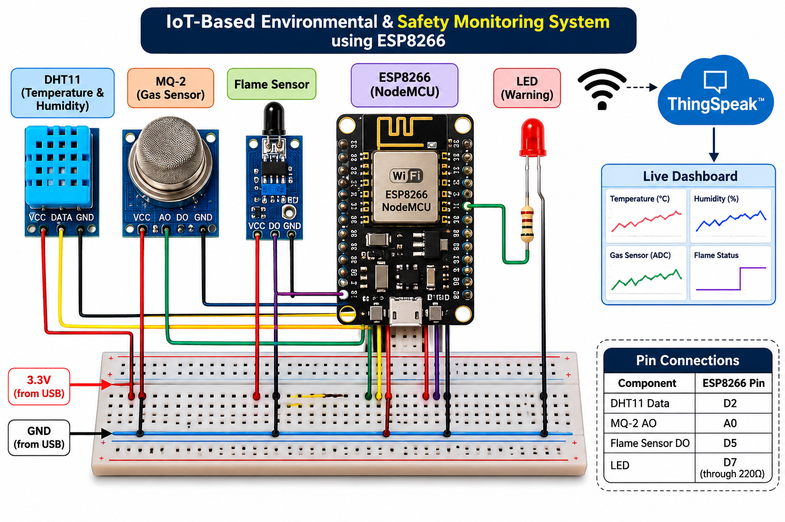
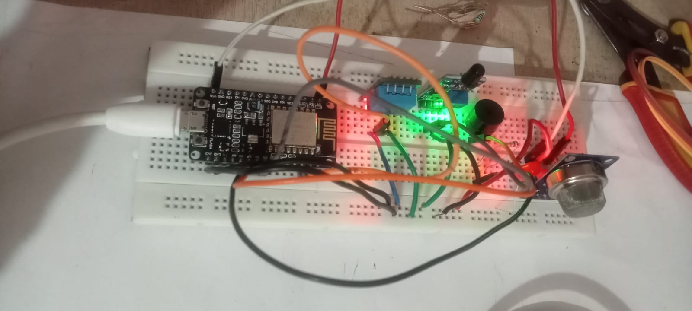
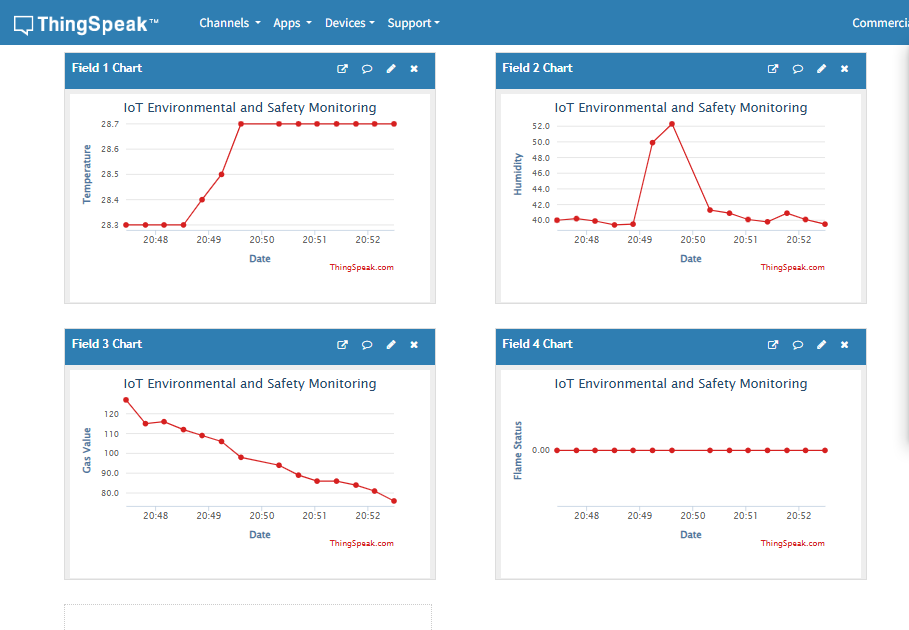

# IoT-Based Environmental & Safety Monitoring System using ESP8266

An IoT-based embedded system designed to monitor environmental parameters and detect potential safety hazards using ESP8266, multiple sensors, and the ThingSpeak cloud platform.

## Overview

This project implements a real-time environmental and safety monitoring system using the NodeMCU ESP8266 microcontroller.

It collects temperature, humidity, gas sensor readings, and flame detection status. The collected data is transmitted over Wi-Fi to the ThingSpeak IoT platform, where it can be monitored through graphical dashboards.

The system also uses an LED as a local visual warning indicator when configured warning conditions are detected.

## Objectives

- Monitor environmental conditions in real time.
- Detect changes in gas sensor readings.
- Identify flame sensor activation.
- Transmit sensor data wirelessly to a cloud platform.
- Visualize collected data using live graphs.
- Implement a basic local warning indication.

## Hardware Components

| Component | Purpose |
|---|---|
| NodeMCU ESP8266 (ESP-12E) | Main microcontroller and Wi-Fi connectivity |
| DHT11 | Temperature and humidity measurement |
| MQ-2 Gas Sensor | Gas and smoke-related sensing |
| Flame Sensor | Flame detection |
| LED | Visual warning indication |
| Breadboard and jumper wires | Circuit connections |
| USB power supply | Power for the development board |

## Software and Technologies

- Arduino IDE
- Embedded C/C++
- ESP8266 Wi-Fi
- ThingSpeak IoT Cloud
- HTTP communication
- Arduino sensor libraries

## System Architecture

```text
DHT11 ───────┐
MQ-2 ────────┤
Flame Sensor ├──> ESP8266 NodeMCU
             │         │
             │         ├──> LED Warning
             │         │
             │         └──> Wi-Fi
             │                │
             │                ▼
             │           ThingSpeak
             │                │
             │                ▼
             └────────> Cloud Dashboard
```

## Pin Configuration

| Component | ESP8266 Pin |
|---|---|
| DHT11 Data | D2 |
| MQ-2 Analog Output | A0 (with suitable voltage scaling) |
| Flame Sensor Digital Output | D5 |
| LED | D7 (through current-limiting resistor) |

**Note:** ESP8266 GPIO pins operate at 3.3V and are not 5V tolerant. Sensor output voltages must be compatible with the board's input limits.

## Features Implemented

- Temperature monitoring using DHT11.
- Humidity monitoring using DHT11.
- Analog gas sensor reading using MQ-2.
- Digital flame detection.
- LED-based warning indication.
- Wireless sensor data transmission.
- ThingSpeak cloud integration.
- Live graphical visualization of sensor parameters.

## ThingSpeak Cloud Monitoring

The system transmits four parameters to ThingSpeak.

| ThingSpeak Field | Parameter |
|---|---|
| Field 1 | Temperature (°C) |
| Field 2 | Humidity (%) |
| Field 3 | MQ-2 Analog Reading (ADC) |
| Field 4 | Flame Detection Status |

The cloud dashboard provides graphical visualization of the collected sensor data.

## Repository Structure






```text
IoT-Environmental-Safety-Monitoring-ESP8266/
│
├── circuit/
│   └── circuit_diagram.png
│
├── docs/
│   └── project_documentation.md
│
├── images/
│   ├── hardware_setup.jpg
│   └── thingspeak_dashboard.jpg
│
├── src/
│   └── Environmental_Safety_Monitor/
│       └── Environmental_Safety_Monitor.ino
│
├── .gitattributes
├── .gitignore
├── LICENSE
└── README.md
```

## Testing and Validation

The following modules were tested during development:

- ESP8266 Wi-Fi connectivity.
- DHT11 temperature and humidity readings.
- MQ-2 analog sensor readings.
- Flame sensor digital output.
- LED output.
- ThingSpeak data transmission.
- Cloud graph updates.

## Applications

- Educational IoT experiments.
- Environmental parameter monitoring.
- Basic laboratory safety monitoring demonstrations.
- Embedded systems and wireless communication learning.

## Limitations

- MQ-2 readings are raw ADC values, not calibrated gas concentrations.
- Sensor accuracy depends on calibration and operating conditions.
- Flame detection depends on sensor placement and environmental conditions.
- The prototype is not a certified fire or gas safety system.

## Future Improvements

- Mobile application integration.
- Notification-based warning system.
- Improved sensor calibration.
- Additional environmental sensors.
- Advanced data analysis and visualization.

## Author
Yash Site
Developed as part of an Embedded Systems and IoT project portfolio.

## License

This project is licensed under the MIT License. See the `LICENSE` file for details.
